# A tour of the training data

Our model learns to decorate a beat by studying how real drummers play. This page shows what it
studies: the **Groove MIDI Dataset** (GMD), recorded by Google Magenta (Gillick et al. 2019,
CC BY 4.0). Ten drummers played an electronic drum kit, and every hit was saved as a MIDI note.

Figures and sounds on this page are made by `make_figures.py`
(run `.venv/bin/python -m data_analysis.make_figures` from the project root).

## 1. Start with the beat we always keep

Every loop we generate is built on the same **skeleton**: a kick drum on every beat
("boom, boom, boom, boom") and a snare on beats 2 and 4. This is what a fitness class moves to.
On its own it is steady but bare. The rest of this page is about the *decoration* we want to add
on top: hi-hats, toms and cymbals.

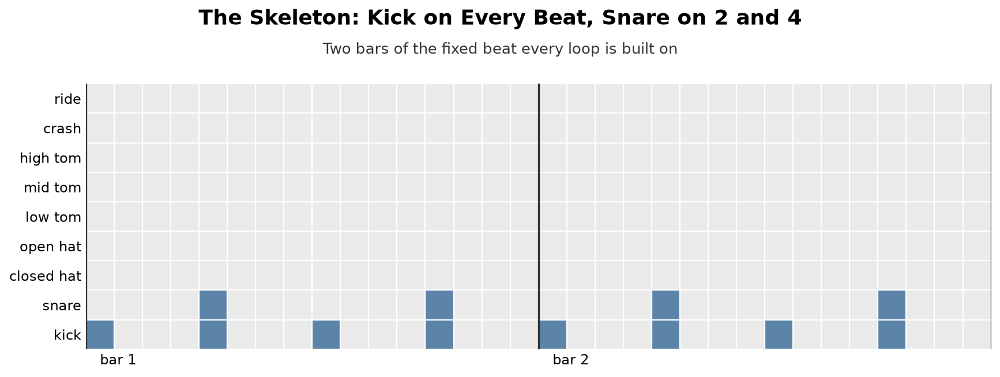

**How to read a drum grid.** Each row is a drum, each column is one 16th note (a bar has 16),
and a filled square means "this drum is hit here". Time runs left to right, like sheet music.

**Listen** (8 bars at 128 BPM, our class tempo):

<audio controls src="audio/skeleton.wav"></audio>

[skeleton.wav](audio/skeleton.wav)

## 2. What is in the dataset

The dataset has 1,150 recordings of two kinds: **grooves** (a steady beat, 503 recordings) and
**fills** (short drum breaks between sections, 647 recordings). Our model learns grooves, so we
use the grooves only.

Of the 503 grooves we keep **all but 12**. Those 12 are not in 4/4 time, meaning 4 beats per bar,
counted "1 2 3 4", the time signature of almost all fitness music. They use 3, 5 or 6 beats per
bar instead (a waltz, for example, is "1 2 3"). We also cut silent bars at the start and end of
each recording (count-ins and waiting before the drummer starts). That leaves **491 grooves** with
about **20,600 bars** of drumming, or 12.6 hours of music.

| Part | Recordings | Bars | Used for |
|---|---|---|---|
| train | 368 | 16,454 | learning |
| validation | 46 | 2,039 | deciding when to stop training |
| test | 77 | 2,104 | one final check at the end |

The split comes with the dataset, so other researchers can compare against the same parts.

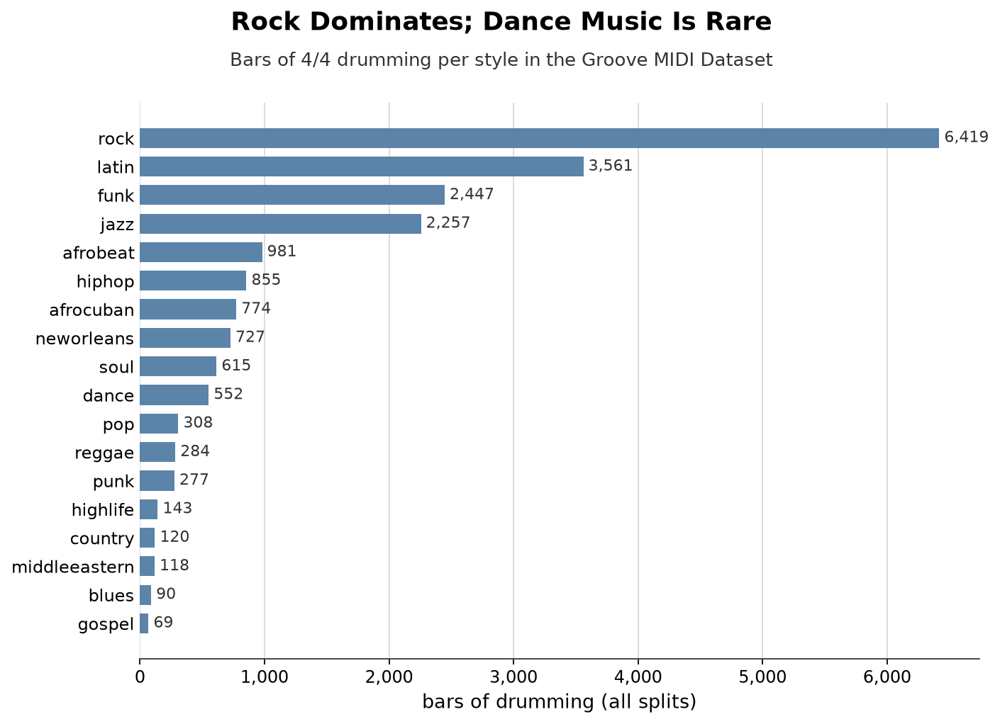

**Rock dominates**, with latin, funk and jazz next. Almost none of it is dance or fitness music
(dance has 552 bars). So the model learns *general human drumming*, not workout music. That is
fine for decoration, but worth remembering when we listen to the results.

<table>
<tr>
<td width="50%" valign="top">
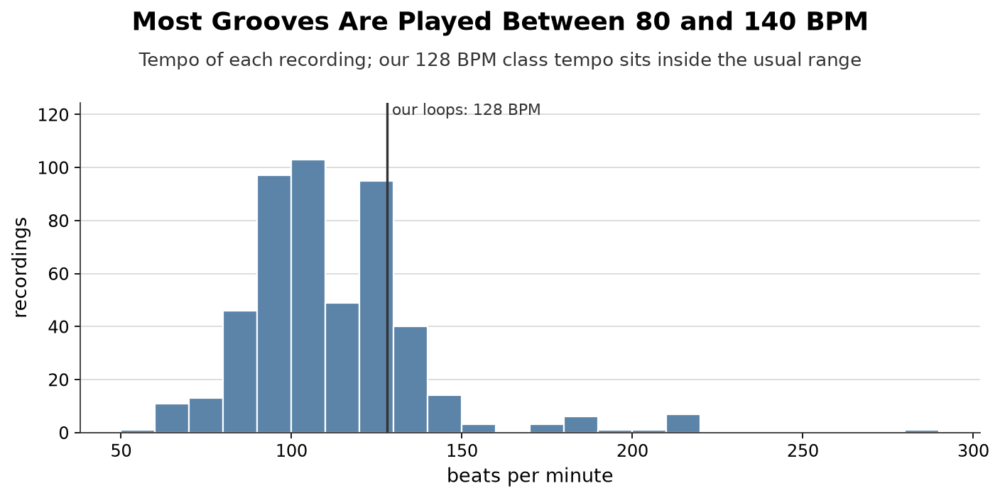

Most recordings sit between 80 and 140 beats per minute (the middle value is 105). Our loops
run at <b>128 BPM</b>, a typical class tempo, which is inside the range the drummers played. The
model never sees tempo anyway: it only sees which 16th note each hit falls on.

</td>
<td width="50%" valign="top">
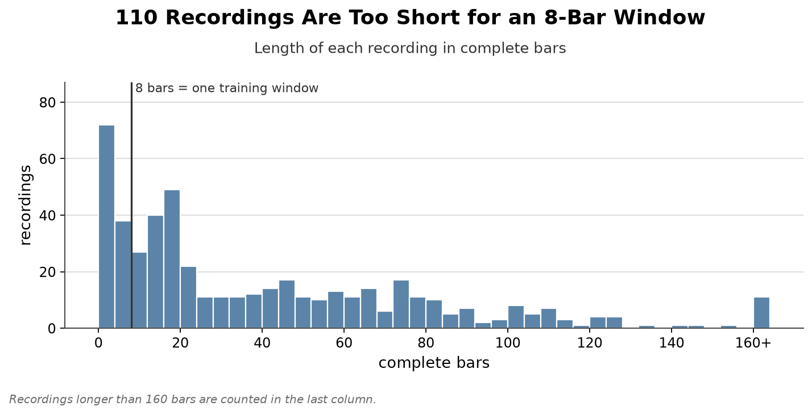

The model learns from <b>8-bar stretches</b>, the same length as the loops it will make.
Recordings shorter than that (110 of them, the tall column on the left) can't provide one, so
they are not used for training. The longer ones are cut into many overlapping stretches.

</td>
</tr>
</table>

## 3. From a performance to a grid

A drummer never plays exactly on the grid: a hit can land a little early or late, and that is
part of what makes drumming feel human. Our model works on a simpler picture: we **snap every
hit to the nearest 16th note** and only keep *whether* a drum was hit, not how hard.

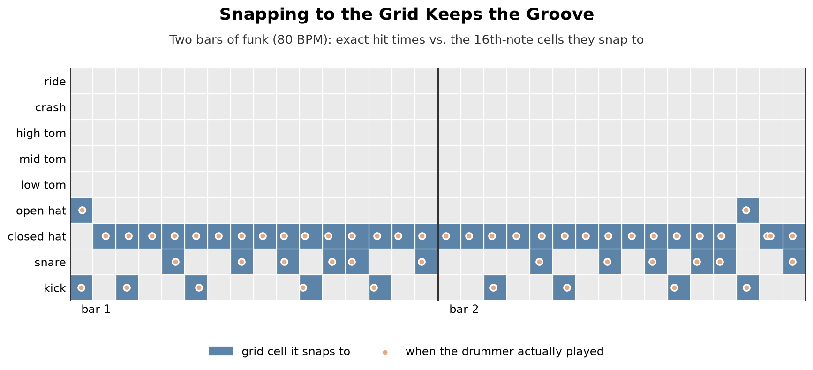

The orange dots are the exact moments the drummer played; the blue squares are where they
end up after snapping. They line up closely, so the groove survives. What we lose:

- **Timing feel** (playing slightly ahead of or behind the beat).
- **Dynamics** (soft "ghost" notes and loud accents all become the same hit).
- The drum kit has more sounds than we use: we group them into **9 drums**
  (e.g. three ways of hitting the hi-hat all count as "closed hat").

## 4. Listen to real grooves

Three recordings from the training set, after snapping (bars 2-9, skipping the count-in).
They were picked by a fixed rule (the first training recording of each style with at least 10 bars),
not chosen for how good they sound. They play at the drummer's own tempo with our simple drum synth,
every hit at the same volume, so they sound more mechanical than the original performance.

**Rock** (half-time feel, 140 BPM)

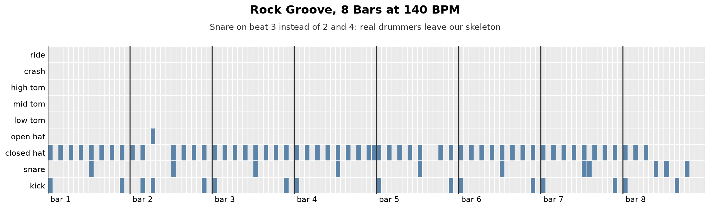

<audio controls src="audio/example_rock.wav"></audio>

[example_rock.wav](audio/example_rock.wav). Notice the snare lands on beat **3**, not on 2 and 4:
a "half-time" feel. Real drummers don't always follow our skeleton, which is exactly why a
model that learns everything freely may not keep the pulse a fitness class needs.

**Funk** (80 BPM)

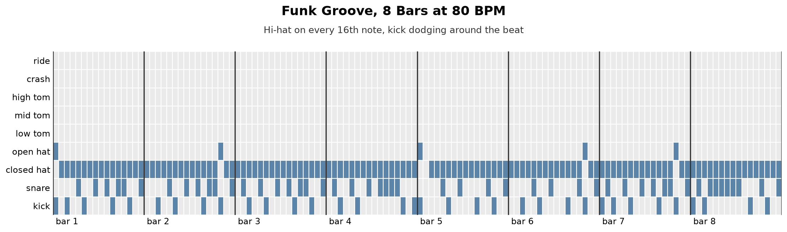

<audio controls src="audio/example_funk.wav"></audio>

[example_funk.wav](audio/example_funk.wav). The hi-hat runs on every 16th note and the kick
dodges around the beat: busy, syncopated decoration.

**Latin** (Brazilian baião, 95 BPM)

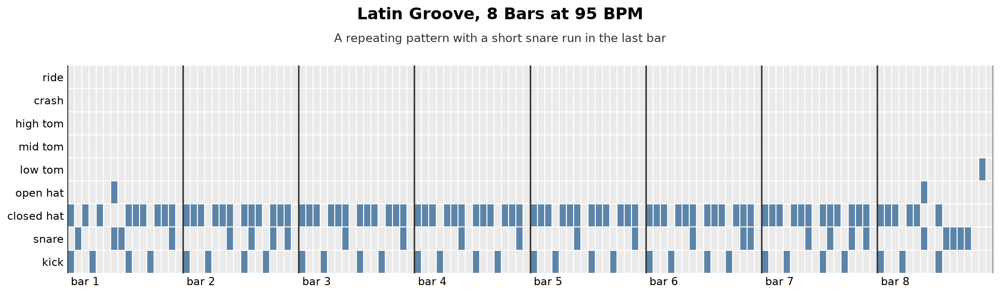

<audio controls src="audio/example_latin.wav"></audio>

[example_latin.wav](audio/example_latin.wav). A repeating pattern that changes a little in the
last bar, where the drummer adds a short snare run.

## 5. How the drummers use each drum

Now across the whole training set (16,454 bars): which drums get played, and where.

<table>
<tr>
<td width="50%" valign="top">
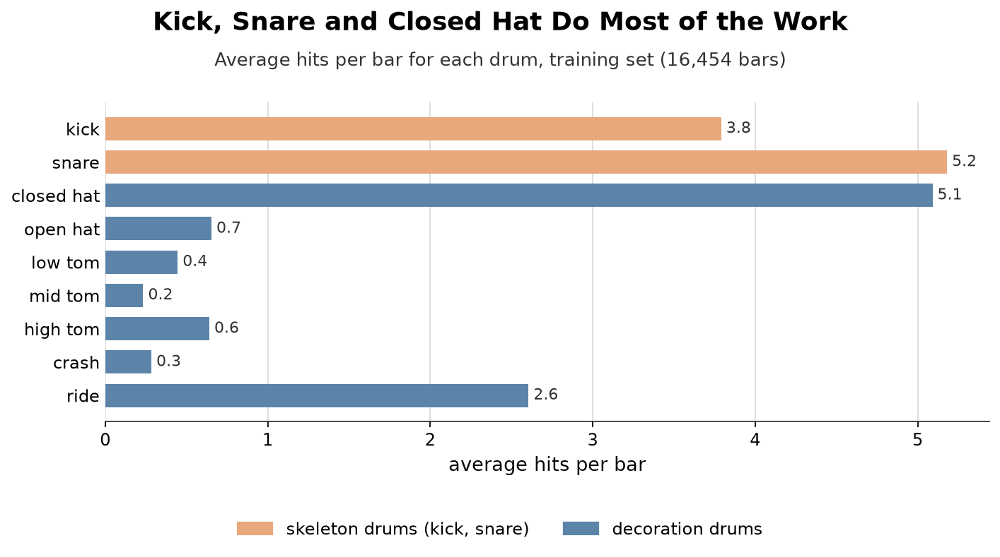

<b>Which drums get played.</b> Three drums do most of the work: <b>kick, snare and closed
hi-hat</b>, with the <b>ride</b> cymbal (the jazz drummer's hi-hat) next. Toms and crashes are
rare accents, a few per recording. The snare plays more than twice per bar because drummers add
quiet "ghost notes" between the main backbeats; on our grid those count as full hits.

</td>
<td width="50%" valign="top">
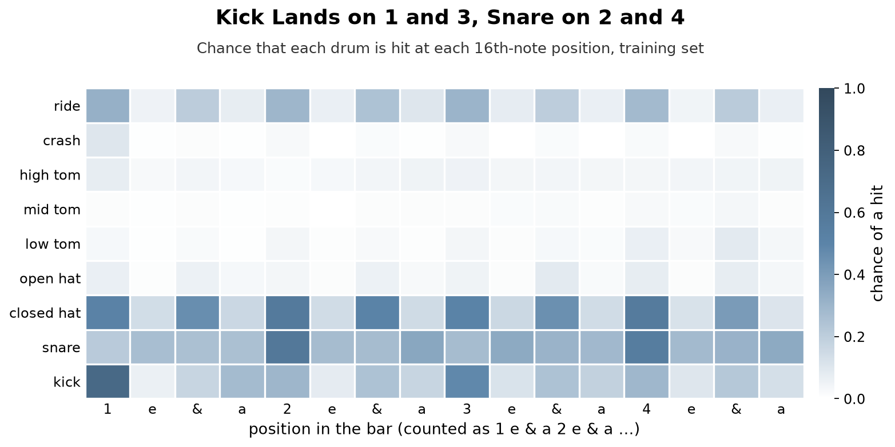

<b>Where in the bar they play</b>, the most useful picture on the page. Each cell is the
<b>chance that a drum is hit at that position</b> (darker = more likely), counted the way
drummers count 16th notes: "1 e &amp; a, 2 e &amp; a, ...".

</td>
</tr>
</table>

What the heatmap shows:

- **Snare** peaks on **2** and **4** (about 6 bars in 10): the backbeat. This half of our skeleton
  is exactly what drummers do most.
- **Kick** is strongest on **1** (72% of bars) and **3** (48%), the classic rock pattern. On 2 and 4
  it plays in fewer than 3 bars in 10, and **only 16% of bars have a kick on all four beats**.
  So the kick half of our skeleton ("four on the floor") is a dance-music habit, not what these
  drummers usually play. Fitness classes want it because it marks every step; the data doesn't
  supply it.
- **Closed hat** follows the beats and the "&"s, which is the classic 8th-note hi-hat pattern.
- The off-beats ("e" and "a") are lighter for every drum. They are where variation lives.

## 6. How busy the decoration is

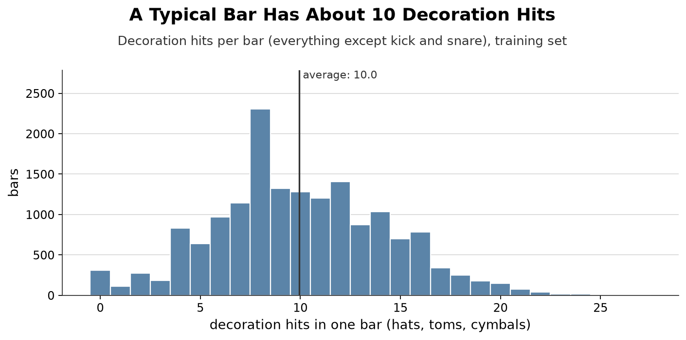

Counting only the decoration drums (everything except kick and snare), a typical bar has
**about 10 hits**: the most common value is 8, i.e. a hi-hat on every 8th note. Only 2% of bars
have no decoration at all (kick and snare only).

The average, **10.0 hits per bar**, is a key number for the project. Our hand-written rule system (A)
is tuned once to play about this much decoration, so that when we compare it with the learned
model we compare *how varied* they are, not simply *how much* they play.

## 7. Real drummers repeat, with small changes

Our aesthetic goal says the groove should keep shifting "rather than one bar looping". How much
do real drummers actually change from one bar to the next? Comparing the decoration of each bar
with the bar before it:

| Decoration | Cells that change from one bar to the next |
|---|---|
| A loop repeating one bar | 0% |
| **Real drummers** | **5.5%** (and 12% of bars are an exact repeat of the one before) |
| Random hits, with the same chance per cell as the drummers | 13% |

Real drumming sits in between: mostly the same pattern, with a few changes each bar. That gives us
a concrete target for "alive": close to 5.5%, not 0 (a drum machine) and not 13% (noise).

## 8. What this means for the project

- **The data is 12.6 hours of real drumming**, mostly rock, latin, funk and jazz, snapped to a
  16-step grid with 9 drums. Decoration lives mostly in the hi-hat and ride, at about 10 hits per bar.
- **The snare half of our skeleton matches the data; the kick half does not.** A model that learns
  freely (B) will imitate drummers who mostly play kick on 1 and 3, so it will miss our skeleton.
  That is a result about the data, not just about the model, so we also score **real drumming**
  with the same measures and read B against it.
- **We measure "alive" as bar-to-bar change**, with the drummers' 5.5% as the reference. A rule
  system that picks every hit at random will likely land near 13%; the question is whether the
  learned model lands closer to the drummers.
- **Ghost notes** (quiet extra snare hits, part of why the snare averages 5.2 hits per bar against
  2 in the skeleton) count as full hits on our grid. We keep them and say so.

> **Audio players:** the players work when viewing this page in VS Code, a local Markdown viewer
> or Jupyter. GitHub doesn't show audio players in README files; use the links under each player
> to open or download the WAV.
